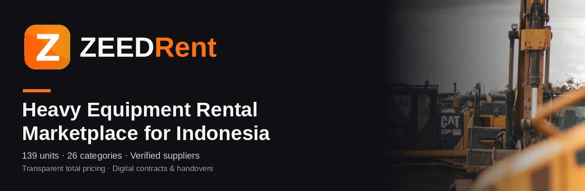
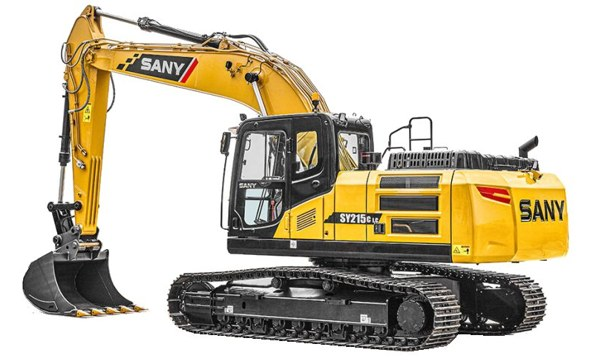
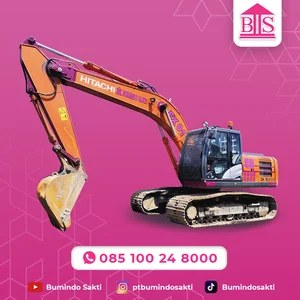
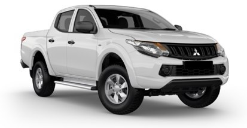
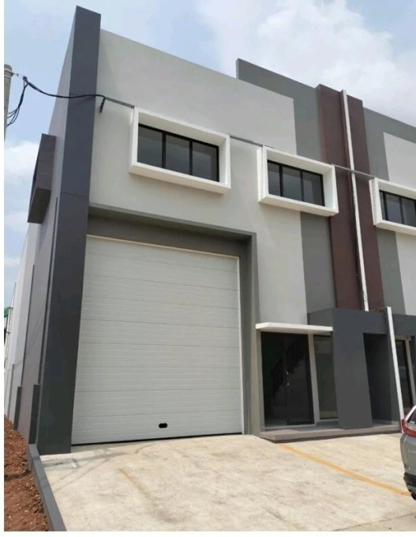

# ZEEDRent — Heavy Equipment Rental Marketplace for Indonesia

**ZEEDRent** (Zonal Equipment Exchange & Delivery) is a one-stop rental marketplace for heavy equipment and industrial machinery across Indonesia, serving construction & EPC, mining, manufacturing, logistics, energy, oil & gas, plantations, marine, and infrastructure projects.

[](https://andikapratamazaid.github.io/website-zeedrent/)


> This repository contains the interactive design demo (front-end prototype) of the ZEEDRent platform. Supplier profiles, units, and prices are realistic sample data calibrated to the Indonesian market (November 2026). The operating company is planned as **PT ZEED Rent Indonesia**.

## Why ZEEDRent

Renting heavy equipment in Indonesia still runs on phone calls, WhatsApp chats, and opaque pricing. ZEEDRent fixes that with a marketplace model proven abroad (DOZR, BigRentz, Digando), adapted to how Indonesian projects actually work:

- **Transparent total pricing upfront** — rent, mobilization, operator, service fee, and tax are itemized before you pay anything. No hidden charges.
- **Open supplier profiles** — every supplier is verified (business license, tax ID, fleet documents) and shows its legal details, yard location, ratings, and policies publicly.
- **Mobilization that matches the machine** — each category ships on the right vehicle (lowbed trailer, self loader, box truck, drive-away, towing pickup) with distance-based estimates to 76 project cities across Indonesia, including inter-island ferry costs.
- **Call to Book** — every unit books straight into a WhatsApp conversation with the full rental breakdown attached.
- **Digital contracts & handovers** — e-stamped contracts and photo-based handover reports (BAST) with an 11-step order timeline.
- **Wet hire & dry hire** — operator-inclusive and operator-optional pricing on the same unit.

## Highlights of this demo

- **139 units in 26 categories** from 5 verified suppliers (Jabodetabek, Cikarang–Karawang, and the East Kalimantan mining corridor)
- **Trilingual interface** — Indonesian, English, and Chinese (中文） with flag switcher, just like a production marketplace
- **Category landing pages** for all 26 categories with live stats, FAQs, related categories, and top cities
- **DOZR-style filters** — keyword, category, class/size, city, and operator options, all combinable
- **Smart search comboboxes** — pick or type equipment types and project cities (76 cities grouped by island; haul trucks are limited to 18 mining-area cities)
- **Warehouses done properly** — multi-use warehouse units rented monthly/yearly with a 5% discount from 12 months, realistic per-m² pricing, nearby toll/port/airport access info, and an embedded location map for every warehouse
- **ZEEDRent HUB blog** — six original Indonesian articles on equipment comparisons, rental costs, and field tips
- Real photography throughout — no AI-generated images

## Categories

| Category | Units | Category | Units |
|---|---:|---|---:|
| Excavator | 5 | Boom Lift | 5 |
| Wheel Excavator | 5 | Scissor Lift | 5 |
| Dump Truck | 5 | Telehandler | 5 |
| Haul Truck | 5 | Mixer Truck | 5 |
| Mining Vehicles | 11 | Lowbed Trailer | 5 |
| Wheel Loader | 5 | Lighting Tower | 5 |
| Motor Grader | 5 | Water Truck | 5 |
| Vibratory Roller | 5 | Air Compressor | 5 |
| Backhoe Loader | 5 | Bulldozer | 5 |
| Forklift | 7 | Welding Machines | 5 |
| Generator Set | 5 | Mining Survey & Monitoring | 7 |
| Crane | 5 | Logistics Trucks | 5 |
| Crawler Crane | 5 | Warehouses | 4 |

Heavy equipment brands follow the Indonesian rental market: **Sany, XCMG, and Caterpillar** across the earthmoving lines, with Hitachi on excavators.

## How it works

**For renters** — search or pick a category → compare units and total prices → open the unit, set dates, duration, and project city → the breakdown (rent + mobilization + operator + fees + tax) updates live → tap **Call to Book** to confirm on WhatsApp → digital contract → tracked mobilization → digital handover → rent, extend, or return.

**For suppliers** — register and verify the company → list units for free → receive orders and RFQs → deliver with a digital handover → get paid on a guaranteed schedule.

## Business model (planned)

- Commission per completed transaction (indicative 5–10% by category, borne by the supplier from the price they set)
- Optional small renter service fee, protection/insurance margin (transparent, via licensed insurers)
- Phase 3: white-label online rental stores for suppliers (SaaS), market price analytics, supplier financing partnerships
- No listing fees — supply growth comes first

## Roadmap

- **Phase 0 — Validation**: interview 20–30 suppliers and 15–20 renters in Greater Jakarta and the Cikarang–Karawang industrial corridor
- **Phase 1 — MVP**: catalog, availability calendar, instant booking + RFQ, e-stamped contracts, platform payments with scheduled disbursement, digital handovers, two-way ratings
- **Phase 2 — Trust & scale**: bundled insurance, GPS/hour-meter telematics, framework rate contracts, mobilization module
- **Phase 3 — Platform**: white-label supplier web stores, procurement/ERP APIs, market analytics, financing

## Tech

Single-file HTML/CSS/JavaScript single-page app (hash routing), no build step, hosted on GitHub Pages. All state (filters, language, project city, price calculation) runs client-side.

```
index.html          # the whole app: data, templates, i18n (ID/EN/中文）, pricing engine
assets/             # unit & category photography, logos, this banner
```

## Screenshots

| Catalog | Unit detail |
|---|---|
|  |  |

| Mining vehicles | Warehouse |
|---|---|
|  |  |

## Disclaimer

Design demo for concept validation. Company names, suppliers, and transaction figures in the catalog are sample data; market prices are indicative estimates for the demo and are confirmed by suppliers at booking time in the production platform.

---

**ZEEDRent** · Zonal Equipment Exchange & Delivery · Planned operator: PT ZEED Rent Indonesia · Sales (demo): +62 857-1444-7951
